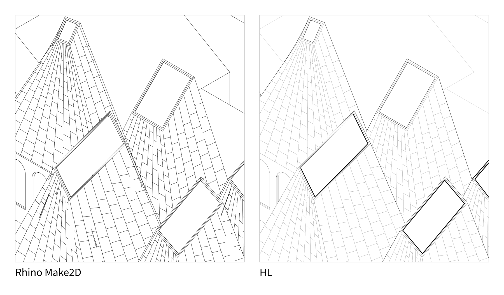
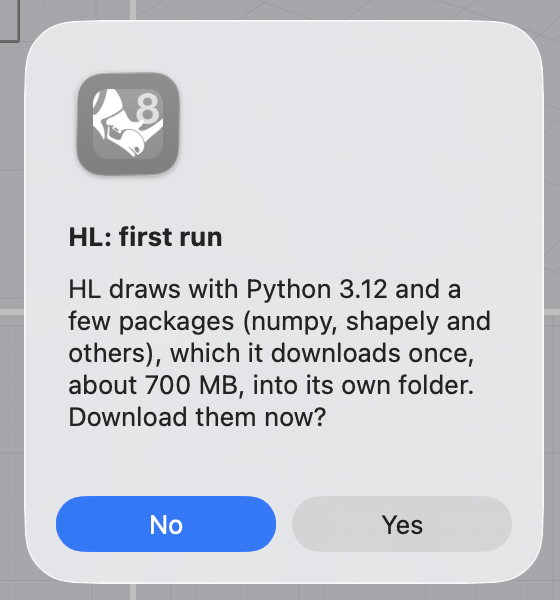
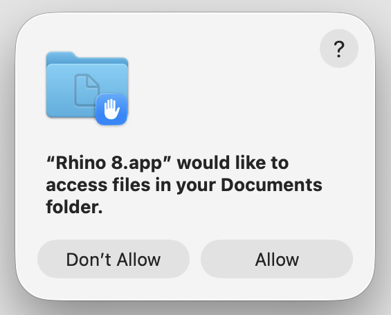
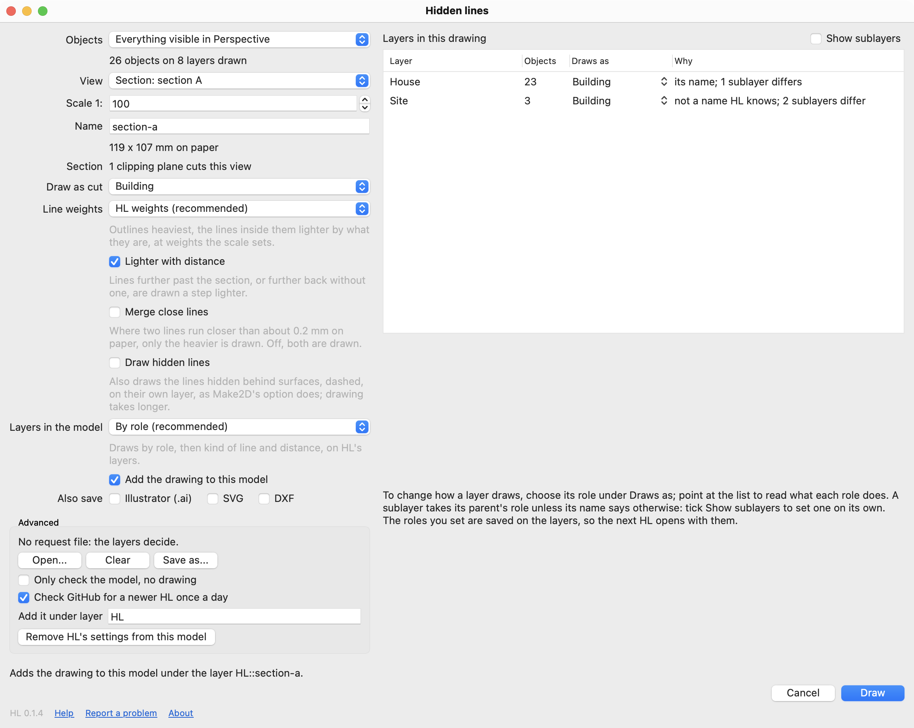
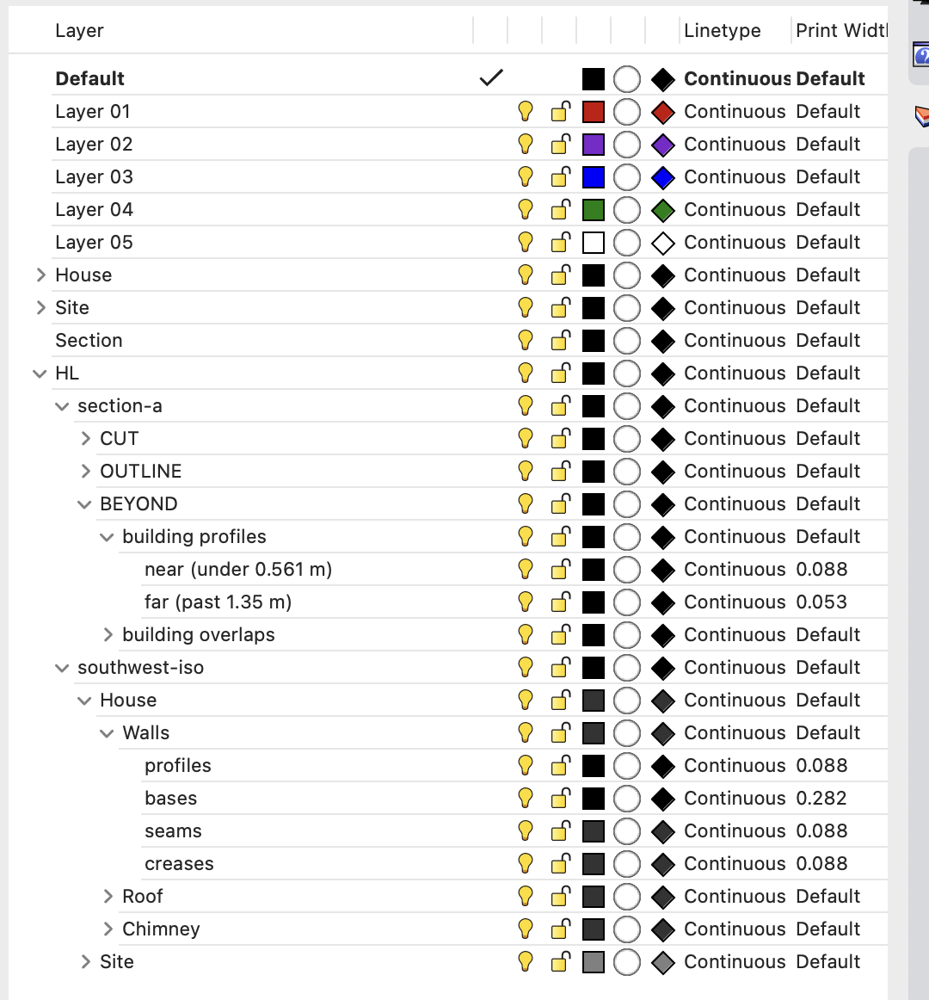
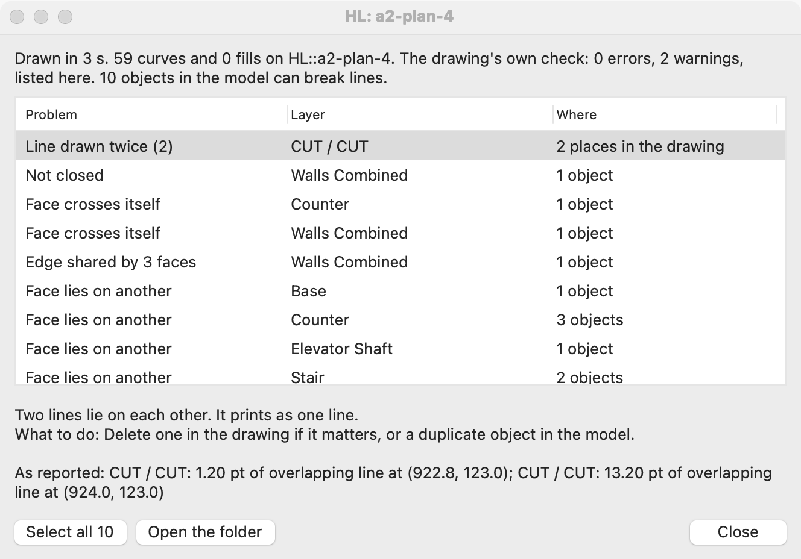
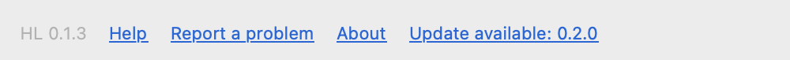

# HL for Rhino 8

HL draws the visible and hidden lines of a Rhino model, the way Make2D does.

Rhino's Make2D (left) and HL (right) on the same view of a model's roofs. Make2D breaks and doubles the tile lines where the roofs meet; HL draws them whole, lighter than the skylights' outlines.

It aims to be a better Make2D, not a finished drawing. It can only draw what the model holds: an open solid, a face that crosses itself or two objects overlapping come out as broken, doubled or missing lines. HL lists those faults after each drawing so you can fix the model. Expect to clean up the result, as you would a Make2D.

The line weights follow from what each edge is: a building's outline, a step, a crease, a line on the ground. A section's cut is drawn as closed outlines, ready to hatch. HL adds the drawing to the model as curves on layers, and writes it as SVG, DXF and Illustrator files.

It runs on Rhino 8 for Mac (Apple silicon and Intel) and Windows.

What it does not do:
- draw text, dimensions or hatches;
- draw objects on a layer you mark "Leave out";
- replace your model's own clipping planes or named views. It reads them.

## Install

1. Get the package for your computer: `hiddenlines-VERSION-rh8_0-mac.yak` or `hiddenlines-VERSION-rh8_0-win.yak`.
2. Install it:
   - **On a Mac,** double-click the file. Rhino 8 opens, if it is not open already, and installs the package without showing a window. Its command line says "Successfully installed HiddenLines". If the file opens another version of Rhino, install it as on Windows.
   - **On Windows,** Explorer does not know the file, so install it from Rhino 8: type `-PackageManager`, choose Install, then Browse, and pick the file.
3. Quit Rhino and open it again.

The first time you type `HL`, it asks to download Python 3.12 and the packages the drawing runs on, about 700 MB. Click Yes. The download takes a minute or two and happens once. HL needs nothing else installed.

### What your computer asks

On a Mac, nothing needs unblocking, even when you downloaded the package in a browser: macOS shows no warning for the package or for what HL downloads. It asks one thing, once for each folder, the first time Rhino opens a model in your Documents, Desktop or Downloads folder, or on an external drive:

Click **Allow**. Rhino needs it to open and save models there, and HL saves each drawing beside its model. Rhino waits for the answer before it finishes opening the model, so if Rhino seems stuck on Loading, look for the question behind your other windows.

A model you have not saved yet has its drawings saved in Documents, in a folder named HL, so for that model the question can come when you click Draw.

If you clicked Don't Allow, HL says it cannot save there. To change it, open System Settings, then Privacy & Security, then Files & Folders, and turn the folder on under Rhino 8.

On Windows, nothing needs unblocking either. A package downloaded in a browser leaves no mark on what Rhino installs, and HL's downloads run without asking. Keep drawings out of folders whose paths run past 260 characters; HL says so at Draw.

## Draw

1. Select what you want drawn, or nothing to draw everything shown in the viewport you are in.
2. Type `HL`. **Objects**, at the top, says which it draws: the selected objects, or everything visible in that viewport.
3. Under **View**, choose one of these:
   - this viewport, as it shows the model now, clipping planes included, in perspective or two-point perspective if it is;
   - Top, Front, Right, Back, Left or Bottom;
   - an isometric;
   - a named view, as it was saved, with its own camera and lens; the clipping planes of the viewport you are in still cut it;
   - **Section** from one of the model's clipping planes, looking at the side it keeps.
4. Set the **Scale**, for example 100 for 1:100, and a **Name**.
5. Check the list of layers on the right. Each layer draws in a role. HL guesses the role from the layer's name, and the Why column says how it chose; change any that are wrong (see Layer roles below). When HL does not recognise some of the names, an orange line under the list says so: those layers draw as Building until you set their role.
6. Check **Line weights** and the three boxes under it (see Line weights below). A grey line under each says what it does.
7. To have the drawing as a file too, tick it under **Also save**: Illustrator (.ai), SVG or DXF, any or none. **Save files in** appears once one is ticked.
8. Click **Draw**. The line above it says where the drawing goes.

The drawing is added to the model under the layer `HL::NAME`, at the world origin. Nothing else is saved unless you tick it under Also save. The files you tick go beside your model in a folder named `<model> HL`, one folder a drawing, with the run's `hl.log`: `NAME.ai` for Illustrator, `NAME.svg` for a browser or Inkscape, `NAME.dxf` for AutoCAD. A model you have not saved yet has them saved in Documents, in a folder named HL. HL remembers the ticks, in the model and for your next model.

HL never saves your model. What it adds is in the open model: the drawing on its layer `HL::NAME`, the roles you set on the layers, and the dialog's remembered choices. On Windows they reach your file when you save it. On a Mac, Rhino saves a model's changes into its file as you work (macOS Auto Save), so they reach the file without you saving, as a Make2D drawing does. To undo them:
- **the drawing**: Undo straight after, or delete its layer `HL::NAME`. Drawing again with the same name replaces it.
- **the roles and the remembered choices**: under Advanced, **Remove HL's settings from this model**. It asks first, and leaves the drawings alone.
- **everything since you last saved**: Revert Changes when closing, or File, Revert To.

If nothing is selected and more than 2,000 objects would be drawn, HL asks first, since a drawing that size can take many minutes.

## Example 1: a plan from a clipping plane

1. Add a clipping plane cutting the model at the height of the plan, its arrow pointing down.
2. Select nothing, type `HL`, and choose **Section: clipping plane 1** under View.
3. Set Scale to 100 and Name to `plan-1`.
4. Under **Draw as cut**, keep **Building**: the walls and floors the plane cuts are drawn as the cut.
5. Click Draw.

## Example 2: an isometric of part of the model

1. Select the building and its ground.
2. Type `HL` and choose **Southwest isometric** under View.
3. Set the scale and name, and click Draw.

The frame fits the building, with a margin; the ground is cut off at the frame.

## Layer roles

| Role | What it is for | How it draws |
|---|---|---|
| Building | walls, floors, roofs, stairs | outlined heavy; cut where a section cuts it |
| Building detail | windows, doors, rails, mullions, beams | lighter, part of the building's mass |
| Furniture | furniture, fixtures, counters | light |
| Texture | roof tiles, cladding, brick | lightest |
| Context | neighbouring buildings, streets | light |
| Ground | terrain, base, grass, curbs | the ground's line, with earth under it in a section |
| See-through | trees and planting | drawn, but hides nothing behind it |
| Lines on the ground | grids, lot lines, door swings | drawn as lines on the floor |
| Hides, not drawn | anything that should hide what is behind it but not show | not drawn |
| Leave out | Make2D drawings, notes, scale figures | not drawn, hides nothing |

- To change a layer's role, choose another under **Draws as**. Point at the list to read what each role does.
- The list shows top-level layers, and a sublayer takes its parent's role unless its own name says otherwise. Tick **Show sublayers** to set a sublayer on its own.
- The Why column says how a layer got its role: set by you, its name, its parent, or not a name HL knows, which draws as Building.
- A layer's name decides its first guess. Plans, Section, Axo, Make2D, Layout and annotation layers are left out, so earlier drawings in the model are not drawn again.
- The roles you set are saved in the model, so the next HL opens with them.

## Line weights

- **HL weights (recommended)**, the default: a building's outline heavy and its inside lines stepping lighter by what they are, set by the scale.
- **From my layers**: each layer's outline at the print width set on it in Rhino (Layer panel, Print width), the other lines stepping down from there as in HL's weights. A layer with no print width set keeps HL's. HL opens on this choice when two or more of the layers drawn have different print widths set.
- **One weight per role**: every line of a role at one weight, as Make2D draws, for you to set in Illustrator or Rhino afterwards.

HL keeps your choice in the model and opens on it there; a model where you have not chosen opens on your last choice.

Three boxes under it change the lines further:
- **Lighter with distance**, on unless you untick it: lines further past the section, or further back in a view with none, are drawn a step lighter. Untick it to draw every line of a kind at one weight, however far. One weight per role turns it off.
- **Merge close lines**, off unless you tick it: where two lines run closer than about 0.2 mm on paper, only the heavier is drawn. Off, both are drawn.
- **Draw hidden lines**, off unless you tick it: also draws the lines hidden behind surfaces, dashed, on their own layer, as Make2D's option does. Drawing takes longer. Turn off the drawing's HIDDEN layer to hide them all again.

## Your drawing's layers

Each drawing comes in under `HL` on a layer of its own name; turn that off to hide the whole drawing. **Layers in the model** opens on **By role (recommended)**. Under the drawing are the same layers its Illustrator file has, in the order Illustrator lists them, from the top. They come in folded:
- **CUT**: what a section cuts.
- **OUTLINE**: the outlines of what the drawing is of.
- **BEYOND**: what a section shows past the cut.
- **DETAIL**: the lines inside the outlines, and a building's details.
- **FURNITURE**, **TEXTURE** (tiles, cladding), **FLOOR** (lines on the ground) and **CONTEXT** (neighbours and the ground).
- **HIDDEN**: the hidden lines, when Draw hidden lines is ticked, dashed, with a sublayer for each role (`building hidden`). Turn HIDDEN off to hide them all.

Open one to see a class for each group, such as `building profiles`. Its distances nest under it: `near (under 2.05 m)`, `middle (2.05–4.92 m)` and `far (past 4.92 m)`, ordered from near to far. With more bands the middle leaves are numbered. The ranges use the model's units, so a model in feet reads feet; without depth bands the class itself holds the lines. Distance is measured past the section, or from the subject's front in a drawing without one.

The class words are profiles (outlines), bases (where something meets the ground), overlaps (an edge in front of a drop), steps, creases (where two faces fold), seams (where parts meet flush), lines, cuts, hidden and above. A group named for its class is written once: `base`, rather than `base bases`.

Each leaf has its own print width. To restyle a whole class, search its name, for example `building creases`, select its distance leaves and set the print width once. Search `far` for the furthest lines. SVG ids and the banded Illustrator swatches leave out the range, so moving a band edge keeps those style keys. SVG and Illustrator preserve the drawing's paint order; where classes interleave, a class appears in more than one container with the same name. Rhino gathers its distances under one class layer.

Choose **As in my model** under **Layers in the model** to nest the source layers instead: `HL::NAME::Model::Furniture::Chairs::profiles`, for example. Each source layer holds its kinds of line, using the class words above, without distance sublayers. Each curve keeps its own print width, ink and linetype, so near, middle and far still print at their weights. Cut joints go under seams; open and thin cuts under cuts. Merged fills keep HL's layers. Since the widths are on the curves, a layer's own print width does not change them: to restyle a layer's lines, right-click it, choose Select Objects, and set the print width in Properties. HL remembers this choice in the model and for the next model.

In either tree, every curve carries user text **hl.layer**, its source layer's full path, and **hl.object**, its source object's id. Use Rhino's `SelUserText` to select all the lines from Chairs, for example. If the export joined several model objects into one, hl.object lists all their ids, separated by commas. Paths spanning more than one source object are split only when added to Rhino; the saved SVG, DXF and Illustrator paths stay as they were.

The layers' colours are the inks they print in: black, and greys for texture and context. Everything is on when a drawing comes in. Drawing again with the same name replaces the drawing and removes the layers it no longer uses.

## The results window

After a drawing, a window shows how long it took, how many curves were added, and what the drawing's own check found: lines that stop just short, short strays, lines drawn twice or side by side. Each kind is a row; click it to select those lines in the drawing and zoom to them, and read what to do. It then lists problems in the model that can break lines, one row for each kind and layer:
- a solid that is not closed;
- a face that crosses itself;
- two solids running into each other;
- and others.

Click a row to select those objects in Rhino. The window says what is wrong and how to fix it. Places where the drawing had to repair or leave a line, and that trace to a problem in the model, are listed first.

## Advanced

- **Request file**: draws from a saved request (a JSON file) instead of the layers. **Save as...** writes one from the dialog's choices.
- **Only check the model**: lists the model's problems without drawing.
- **Add it under layer**: the layer the drawing goes under, `HL` unless you change it, for example `Drawings::Sections`.
- **Check GitHub for a newer HL once a day**: see Help, problems and updates below.
- **Remove HL's settings from this model**: takes the roles HL kept on the layers and the dialog's remembered choices out of the model, after asking. The drawings on HL's layers stay; delete those yourself if you want them gone.

## When something goes wrong

HL says what went wrong in its window instead of stopping Rhino, and keeps a log of every run: `hl.log` beside the files a drawing saves, or, for a drawing that saves none, `hl-DATE-TIME.log` in `.rhinocode/kit-hl/logs` in your home folder. The window's **Open the log** button opens it. To report a problem, attach the log.

- **"HL is already drawing …"**: one drawing at a time in a Rhino, and one Rhino at a time drawing a name in a folder. Wait, or press Esc to stop the other.
- **"The drawing would be … across on paper"**: an object far from the rest makes the sheet too big; HL selects it. Hide or move it, or select what to draw.
- **"This drawing needs about … GB of memory"**: a drawing past most of the computer's memory can run very slowly or stop. Draw part of the model, or say Yes to try.
- **"The Python and packages HL downloaded look damaged"**: say Yes and HL downloads them again.
- **"The download stopped"**: the first run needs the internet; run HL again once you are online.
- **Esc** stops a drawing at any stage, and quitting Rhino stops it too.

## Help, problems and updates

The line at the bottom of the dialog shows HL's version and three links:
- **Help** opens this guide on GitHub.
- **Report a problem** opens a new issue on GitHub with the versions of HL, Rhino and your system filled in, and nothing else. Say what happened, and attach the log.
- **About**: HL is by Kenny Vo, under the MIT licence, at https://github.com/kenny-t-vo/hidden-lines.

When the dialog opens, at most once a day, HL asks GitHub's releases API for its latest release. The request carries nothing about you or your model. When a newer release exists, the line adds **Update available**, linking to its release notes. Offline, or when GitHub does not answer within 3 seconds, HL says nothing and asks again the next day. To turn this off, untick **Check GitHub for a newer HL once a day** under Advanced.

## Update and uninstall

To update, install the newer package the same way and restart Rhino. To uninstall, use `_PackageManager`, Installed, HiddenLines, Uninstall. Then delete the folder `.rhinocode/kit-hl` in your home folder (on Windows, `%USERPROFILE%\.rhinocode\kit-hl`). It holds HL's copy of its files, the Python and packages it downloaded (about 650 MB) and its logs.

## How it works

HL runs in two steps. In Rhino it exports what you chose to draw: the exact visible and cut curves from Rhino's own hidden-line engine, the one Make2D runs, and a mesh of every object. Then, on its own Python, it decides what is seen from those meshes' faces with a buffer of the face in front at each point, joins the curves where they meet, sorts each line into a class (an outline, where something meets the ground, an edge in front of a drop, a step, a crease, a seam), weights it by its class and its distance, closes each section's cut into outlines, and writes the drawing. The export keeps what it works out, so exporting the same objects again is quicker.

## From the command line

The drawing step runs without Rhino from this folder: `python3 kit.py hidden-lines REQUEST.json` draws an export that the Rhino side wrote, and `python3 kit.py lint FILE.svg` checks a drawing for lines that stop short, strays and doubles. `docs/commands.md` describes both and the request's format. It needs Python 3.10 to 3.12 with uv on the PATH, through which `kit.py` fetches its packages the first time.

## Development

`python3 kit.py test` runs HL's tests on the synthetic scenes in `tests/fixtures/`. The plug-in is built on a Mac with Rhino 8 by `rhino/plugin/build.py`, whose docstring says how. Issues and pull requests are welcome; a model that draws wrongly, attached to an issue with its log, helps most.

## Licence

HL is under the MIT licence (`LICENSE`). Its packages carry Astral's uv, under uv's MIT and Apache 2.0 licences (`rhino/plugin/uv-licenses/`). Rhino and its hidden-line engine are McNeel's.
